# Broke Student Grocery Agent

One section per build, newest at the bottom.

## Build 0: full flow (DRAFT, before code)

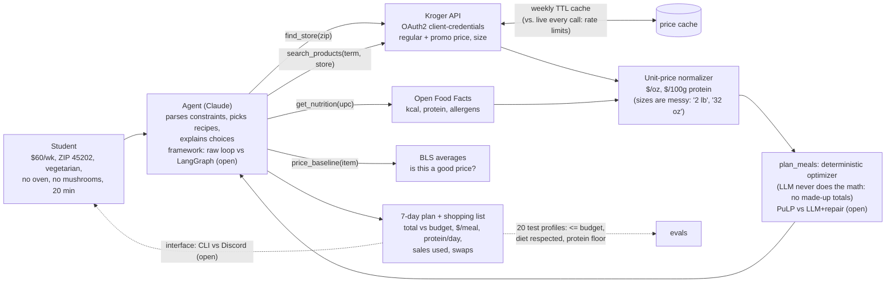

Piece 1 (next): token -> nearest store to 45202 -> search "rice" -> print 5 real prices.

## Stage 1: Kroger token -> nearest store -> rice prices (BUILT, kroger/kroger_piece1.py)

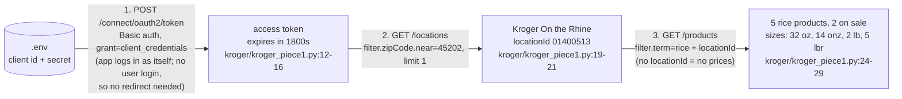

Decision: get a new token on every run (simple) vs. cache it until it expires (fewer calls).
Piece 1 fetches a new one each time; caching comes in Stage 3.

Real run (2026-11-17, ZIP 45202, 3 API calls, 2.2 s total):

| Product | Size | Regular | Promo | $/lb (best price) |
|---|---|---|---|---|
| Kroger Long Grain White | 32 oz | $1.89 | - | **$0.95** |
| Mahatma Jasmine | 5 lb | $7.49 | $6.99 | $1.40 |
| Mahatma Extra Long White | 32 oz | $2.89 | - | $1.45 |
| Kroger Jasmine | 2 lb | $3.99 | - | $2.00 |
| Minute Instant White | 14 oz | $2.99 | $2.49 | $2.85 |

Cheapest is $0.95/lb, 14% below the BLS national average for white rice ($1.101/lb, Oct 2026).
Minute is on sale ($2.49) but is the most expensive per pound: 3x the Kroger rice. "On sale" is not the same as "cheap", which is why Stage 3 normalizes unit prices.
Messy units seen: "oz", "onz", "lb", "lbr", so the unit parser has to handle variants.

## Stage 2: cookbook PDF -> text -> one chunk per recipe (DRAFT, before code)

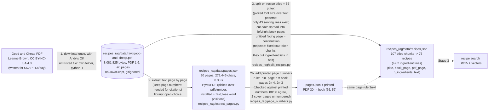

Source: author's original file (cookbooks.leannebrown.com/good-and-cheap.pdf) via the Wayback Machine snapshot of 2024-07-21,
because her site no longer links to it. We picked it over obooko's re-upload, which we couldn't check against hers.
Downloaded 2026-11-17, sha256 d23f8476...c6a6. Not committed (CC BY-NC-SA: we use it, we don't redistribute it).

Piece 1 run (2026-11-17): 90 PDF pages -> 279,445 chars in 0.30 s, 0 empty pages.
Surprise 1: each PDF page is a 2-page spread (PDF page 30 shows printed page 56). Citations must use the printed number, not the PDF index.
Surprise 2: ingredient lines look like "\t4\tlarge sweet potatoes" (tab, quantity, tab, item): an easy signal for the recipe splitter.
Surprise 3: titles break across lines ("Smoky / and Spicy / Roasted / Cauliflower") and serving size is letter-spaced ("f o r f o u r").

Piece 2 run (2026-11-17): rule "PDF page n = book pages 2n-4 and 2n-3" matches the printed number on 88 of 88 numbered pages, 0 disagree; PDF pages 1-2 (cover) have no number.
Decision: use the rule and check it against the text (rejected: reading numbers from text only, since 2 pages have none and some pages show a number twice).

Piece 3 run (2026-11-17): 107 chunks with a 36 pt title -> 75 recipes (>= 2 ingredient lines like "\t4\tlarge sweet potatoes"); the other 32 are section pages (Breakfast, Soup, Index...).
Fix 1: "Spicy Pulled Pork" (p.128) had 0 ingredients because they sit on the facing page 129 -> attach untitled facing pages: 72 -> 75 recipes.
Fix 2: first version attached ANY untitled page, so "Egg Sandwich" swallowed 6 pages (42 ingredients) -> only the facing page of the same spread: back to 15.
Known misses (~4): title fragments like "Cauliflower" (p.77), "And Mine" (p.101), "Deviled Eggs" (p.130). Bonus: the book prints "$1.40 / serving" -> a free check for Stage 4 pricing.

## Project layout: one folder per skill (2026-11-17)

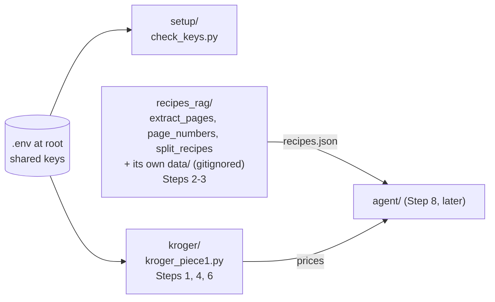

Decision: each skill keeps its own data/ (picked over one shared data/: change a skill = touch one folder; cost: the agent reads from several folders).
Scripts find files relative to themselves (`Path(__file__)`), so they run from any folder. Rerun after the move: 90 pages, 88/88 page numbers, 75 recipes, rice $0.95/lb: same as before.

## Stage 2 v2: recipe cards WITH photos, shown in the student's chat (DRAFT, before code)

Why v2: the font-size splitter found max 1 recipe per book page, but pages hold several (small titles missed), plus 152 photos and idea/lunch pages.

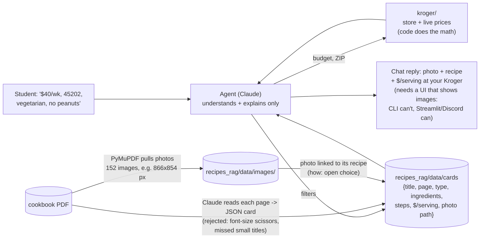

Test (2026-11-17): PDF pages 30-31 -> 4 photos extracted (Jacket Sweet Potatoes 866x854, Spicy Green Beans 402x854...).
Bug seen: a photo spanning the spread's middle (x=602-1225, page width ~1224) was tagged to the wrong book page (56, not 57) -> position alone is fragile.

### Stage 2 v2 test: Claude reads ONE spread (recipes_rag/read_page.py, 2026-11-17)

Test spread: PDF page 37 = book pages 70-71, 4 toast recipes + 4 photos, 0 big titles (the font-size splitter found NOTHING here).

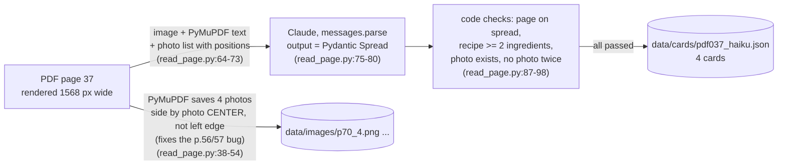

| Model | Cards | Tokens in / out | Cost | Time | Recipes, prices, photos correct |
|---|---|---|---|---|---|
| Haiku 5.5 | 4 | 3,797 / 1,177 | $0.0010 | 5.2 s | 4/4, 4/4, 4/4 |
| Opus 5.5 | 4 | 3,797 / 1,177 | $0.0387 | 9.1 s | 4/4, 4/4, 4/4 (same cards, different order) |

Decision: Haiku is enough for this layout, at 1/39 of the Opus cost. Whole book on Haiku ~ 90 x $0.001 = ~$0.09.
Not yet tested: spreads with idea boxes, section pages, and 7 photos (PDF 69).

Two harder spreads on Haiku 5.5 (2026-11-17):

| Spread | Right answer | Haiku got | Cost / time |
|---|---|---|---|
| PDF 18, p.32-33 | 1 idea page "Yogurt Smash!", no price, no ingredient list, 2 photos | 1 card, kind = idea, no price, big photo p32_1 | $0.0008 / 5.3 s |
| PDF 69, p.134-135 | 1 recipe "Dumplings", 19 ingredients in 4 groups, steps run onto p.135, 1 main + 6 step photos, "$0.12 / dumpling, makes sixty" | 1 card, 19/19 ingredients, all steps incl. p.135 (2,644 chars), main photo p134_1 | $0.0014 / 7.4 s |

Haiku read everything correctly. The 2 misses are in OUR card schema, not the model:
1. Price unit: "$0.12 / dumpling" was saved as cost_per_serving = 0.12 (the card has no unit field).
2. Ingredient groups lost: veggie filling OR pork filling became one flat list, so a vegetarian filter would wrongly drop Dumplings (or an allergen check would see pork).
3 spreads total: 6/6 cards correct, $0.0032, 18 s.

Card format v2 + retest (2026-11-17): Card now has makes, unit_cost + cost_unit, and ingredient_groups (name, items, pick_one_of).

| Spread | v1 | v2 (after fix) |
|---|---|---|
| PDF 37 toast x4 | 4/4 correct | 4/4 correct, $X/serving unchanged |
| PDF 18 yogurt idea | 1 idea card | 1st try: idea + a duplicate "section" card from the labelled photo -> prompt line "photo-only page = no extra card" + duplicate-title check -> 1 idea card |
| PDF 69 Dumplings | "$0.12/serving", 1 flat list of 19 | "$0.12/dumpling", makes sixty, 4 groups: Dough 4, Veggie 7 + Pork 6 (pick one: filling), Additions 2 |

3 spreads: 6/6 cards correct, $0.0033, 16.5 s, all code checks passed.
Wobble seen: the yogurt idea card listed 11 foods from the photo (incl. peanut butter) on one run and 0 on the next. Idea cards are not reliable for allergens yet.

### Decision: store recipe cards as JSON (2026-11-17)

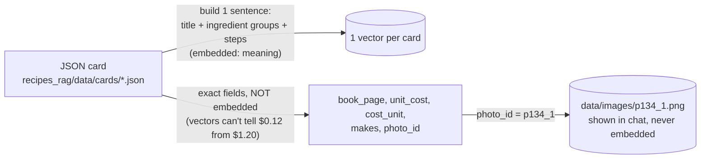

Picked JSON cards (A) over one Markdown file per recipe (B): the planner and Kroger pricing read numbers straight from fields; a Markdown preview can be generated later.

### Full book run: Haiku 5.5 on all 90 spreads (recipes_rag/run_all.py, 2026-11-17)

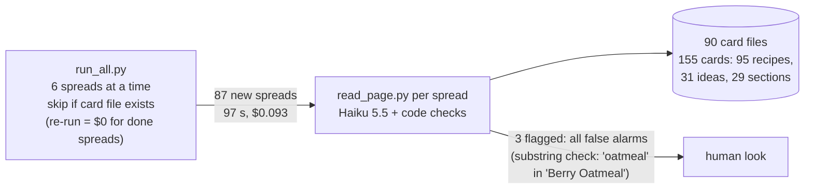

| | Old font-size splitter | Claude reads pages (Haiku) |
|---|---|---|
| Recipes found | 75 | **95** (+20, incl. Deviled Eggs and the 4 toast recipes on p.70-71) |
| Idea pages kept apart | no | 31 idea cards |
| Recipes with a photo | 0 | 92 / 95 |
| Recipes with a printed price | 0 | 88 / 95 (units: serving 66, cup 7, muffin, scone, bar) |
| Alternatives kept ("pick one") | no | 5 recipes (Dumplings, Rainbow Rice, Deviled Eggs...) |
| Cost | $0 | $0.093 for the book (+ $0.006 of tests) |

Same title twice (3 cases) = real "on toast" versions (p.72-73) of main recipes (p.43, p.95, p.122). Search must keep both and say which page.
Check to improve: the duplicate-title rule flags variations ("Berry Oatmeal") as duplicates -> compare whole titles, not substrings.

## Stage 3: recipe search (DRAFT, before code)

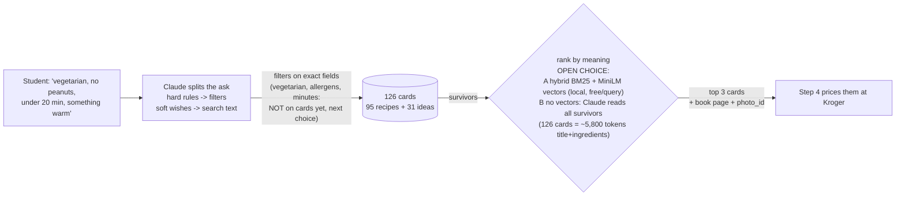

### Stage 3 piece 1: hybrid search, no filters yet (recipes_rag/search.py, 2026-11-17)

Picked A (hybrid BM25 + MiniLM vectors, fused by RRF k=60) over B (Claude reads all 126 cards): free per search, scales to thousands.
126 cards (95 recipes + 31 ideas) embedded locally; 4 questions in 17 s total (mostly loading the model once).

| Question | #1 result | Verdict |
|---|---|---|
| "something warm with tofu" | Tofu Hot Pot p.106 (words #4, meaning #1) | good; but #3 = Peanut Sauce -> allergen filter needed |
| "cheap breakfast" | "Buy expensive eggs if you can" p.10 (a TIP), then Oatmeal $0.13 | tips leak in as "idea" cards |
| "spicy vegetable dinner" | Spicy Green Beans p.59 | good |
| "comfort food for a cold day" | freezer tip p.11, Cold Asian Noodles p.50 | FAIL: BM25 matched the word "cold"; vectors didn't map "cold day" to soup |

Lessons: words and meaning disagree a lot (Popcorn: words #2, meaning #8). Fusion only helps if at least one side understands the ask.
Fixes in order: 1) drop tip cards (ideas with 0 ingredients); 2) Claude rewrites the ask before search ("cold day" -> "warm soup or stew").

### Stage 3 piece 2: Haiku labels each card with a category (Andy's design)

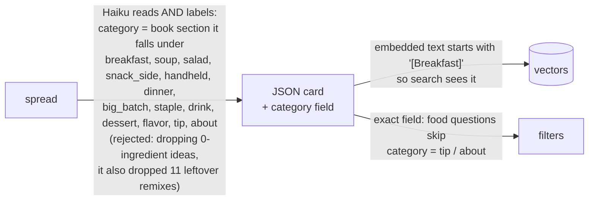

Result (2026-11-17): re-read all 90 spreads with category (95 s, $0.097). 187 cards: 95 recipes, 57 ideas, 35 sections.
Categories: snack_side 30, tip 29, dinner 21, breakfast 20, handheld 20, about 16, salad 11, staple 9, soup 7, drink 7, dessert 6, flavor 6, big_batch 5.
Two prompt rules added on the way: "list of named ideas = one card each" (the 11 leftover wraps had collapsed into 1 card).
Search now skips tip/about/section cards: 125 food cards.

| Question | Before categories | With categories |
|---|---|---|
| "cheap breakfast" | #1 = tip "Buy expensive eggs" | Oatmeal 6 Ways, Tomato Scrambled Eggs $1.80, Yogurt Smash! (all breakfast) ✅ |
| "something warm with tofu" | Tofu Hot Pot | Tofu Hot Pot (unchanged) ✅ |
| "spicy vegetable dinner" | Spicy Green Beans | Spicy Green Beans (unchanged) ✅ |
| "comfort food for a cold day" | freezer tip, Cold Noodles | Empanadas, Cold Noodles (words #1), **Dal (meaning #1, words #74)** ⚠️ |

"Cold day": vectors now find Dal (a warm soup) at #1, but BM25 still drags in "Cold" Noodles. Next fix: Claude rewrites the ask before search.

## Extraction evals (DRAFT, before code)

Code checks (page exists, >= 2 ingredients) prove a card is well-formed. Evals prove it is RIGHT, against hand-checked answers.

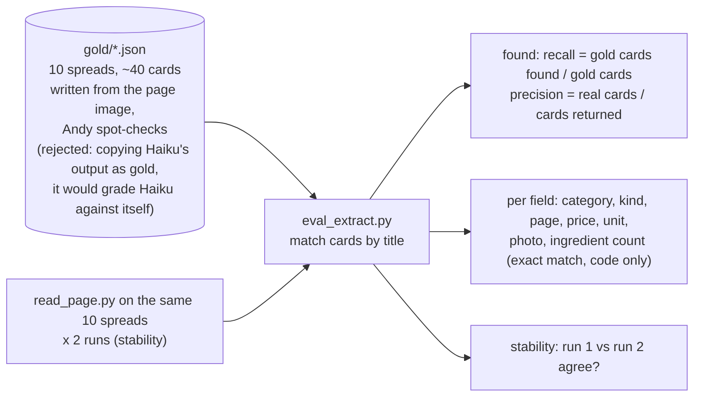

### Extraction eval: built and run (recipes_rag/evals/, 2026-11-18)

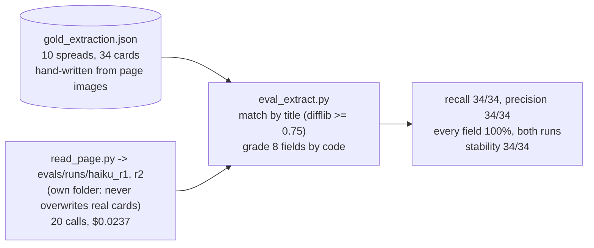

Grader tested first: 3 planted errors (unit dumpling -> serving, swapped photo, deleted Tilapia Taco) -> all 3 caught. Dry run on the production cards: 34/34 found, 1 EXTRA card ("Avocado Milkshake tip from John" on PDF 81) that did not come back in the 2 fresh runs = a rare wobble.

Honest limits: 3 of the 10 spreads (18, 37, 69) were used to tune the prompt, so they flatter the score; 34 cards is small (one miss = -3 points); gold was written by Claude Opus from the images (a different model from Haiku), Andy to spot-check. Next: add 10 held-out spreads nobody tuned on.

## Search evals (DRAFT, before code): the scoreboard DSPy will need

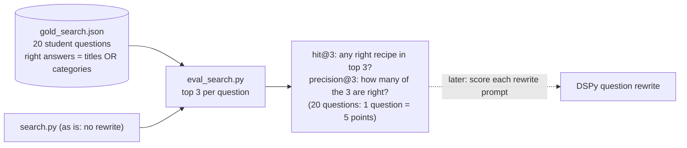

### Search eval baseline (recipes_rag/evals/eval_search.py, 2026-11-18, $0)

**hit@3 15/20 = 75% | precision@3 29/60 = 48%** (search.py as is, no rewrite).
One gold bug found and fixed first: "Calzone" vs the real title "Calzones" (pizza night went 2/3 -> 3/3).

All 5 misses are vague, intent-style questions: the words don't name the food.

| Missed question | What search did | What a rewrite would send |
|---|---|---|
| sweet treat after dinner | BM25 matched "sweet" -> Jacket **Sweet** Potatoes x2 | "dessert: cookies, cake, sorbet" |
| quick lunch I can eat with my hands | Fresh Pasta, Roasted Vegetables | "handheld: wrap, taco, sandwich, calzone" |
| cook once, eat all week | Spinach and Chickpea, Stroganoff | "big batch, freezes well, leftovers" |
| something cheesy and melty | spice cards, Agua Fresca | "cheese, cheddar, mozzarella, melted" |
| something I can make ahead and freeze | Quiche, Melon Sorbet ("frozen melon") | "big batch, dumplings, freeze" |

This is the scoreboard DSPy will optimise the question rewrite against (target: lift hit@3 above 75%).

## Stage 3 piece 3: question rewrite with DSPy (DRAFT, before code)

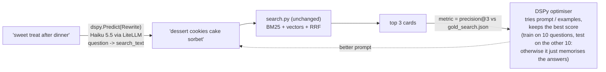

### Question rewrite, zero-shot (recipes_rag/rewrite.py, DSPy 3.5.0, 2026-11-18)

Bug on the way: DSPy call -> HTTP 404. Cause: this app sets ANTHROPIC_BASE_URL = https://api.anthropic.com (no /v1).
The Anthropic SDK appends /v1/messages (works); DSPy's lm15 engine appends only /messages -> api.anthropic.com/messages = 404.
Fix: dspy.LM(..., api_base="https://api.anthropic.com/v1") in rewrite.py.

| | Raw question (baseline) | Haiku rewrites first (no optimising yet) |
|---|---|---|
| hit@3 | 15/20 = 75% | **19/20 = 95%** |
| precision@3 | 29/60 = 48% | **42/60 = 70%** |
| cost | $0 | $0.0010 for 20 rewrites |

Fixed: "sweet treat" (0/3 -> 2/3), "lunch with my hands" (0/3 -> 3/3), "cold day" (1/3 -> 3/3), "cheesy and melty" (0/3 -> 2/3).
Still missed: "cook once, eat all week" (0/3) -> rewrite said "batch cooking, meal prep", search found Jambalaya/Quiche.
Weakness: rewrites invent dishes the book doesn't have ("iced tea, lemonade, mac and cheese") -> noise in search.
Two more gold typos found (Calzone/Calzones, Quesadilla/Quesadillas) -> eval_search.py now refuses to run if a gold title matches no card (tested with a planted "Rotii").

### DSPy BootstrapFewShot (recipes_rag/evals/optimize_rewrite.py, 2026-11-18): REJECTED, made it worse

Split (seed 7): train 10 questions, test 10 never seen in training. 24 Claude calls, $0.0015.

| On the 10 TEST questions | zero-shot | few-shot (4 examples) |
|---|---|---|
| hit@3 | 9/10 | 7/10 |
| precision@3 | 21/30 | 15/30 |

Why: BootstrapFewShot kept the FIRST 4 train rewrites that scored >= 2/3, and all 4 were long lists of generic dish names
("grilled cheese, macaroni and cheese, quesadilla, budget cheese dishes"). The prompt copied that style:
- "lunch with my hands" 3/3 -> 0/3: wrote "hand-held ... quesadillas, burritos"; BM25 splits "hand-held" into hand + held, so it no longer matches [Handheld]; quesadillas pulled cheese dishes.
- "sauce or dip" 2/3 -> 0/3: "hummus, pesto, gravy, cheese sauce" = dishes the book doesn't have.
Lesson: examples teach STYLE, good or bad. A rewrite that passed on its own question can be a bad teacher.
Decision: keep zero-shot as the default (rewrite.py does not load rewrite_fewshot.json). Test set of 10 = 1 question is 10 points, so treat the gap as a warning, not proof.

Decision (Andy, 2026-11-18): stop tuning; keep the zero-shot rewrite (95% hit@3, 70% precision@3 on 20 questions).
Overfitting guard rails for later: (1) always score on held-out questions; (2) only add instructions that are facts about the BOOK
(its section names), never about specific test questions; (3) grow the question set from real student questions once the app runs;
(4) safety net option: search the raw question AND the rewrite, merge with RRF, so one bad rewrite can't empty the results.

## Stage 3 piece 4: diet + allergen fields (DRAFT, before code)

No re-reading of the book: the ingredient lists are already in the JSON cards.

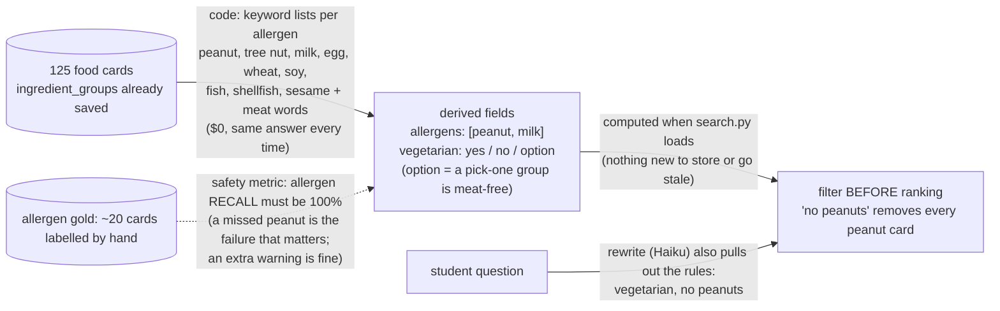

### Diet + allergen fields: built (recipes_rag/diet.py + evals/eval_diet.py, 2026-11-18, $0)

Picked code keyword lists (A) over Haiku tagging (B): same answer every time, checkable line by line, $0.
How: lowercase -> swap "false friends" (peanut butter -> peanut, butternut -> squash, eggplant -> aubergine, coconut milk -> coconut,
butter knife -> knife) -> whole-word match per allergen over title + ingredients + steps -> follow "(p. 164)" to the referenced recipe.
Vegetarian: 'no' if a required ingredient is meat/fish; 'option' if meat only in optional items, additions, variations or one pick-one choice.

Gold: 22 hand-labelled trap cards (recipes_rag/evals/gold_diet.json). Safety rule: optional ingredients count.

| Metric | Result |
|---|---|
| allergen RECALL (safety) | **55/55 = 100%** (every trap caught: butternut, eggplant, coconut milk, raita via p.164, peanut sauce via p.161) |
| allergen precision | 55/60 = 92% (extra warnings: "toast them" = verb; page refs pulling in optional extras) |
| vegetarian | 21/22 (Roasted Vegetables "pair with roast chicken" -> 'option' instead of 'yes': harmless direction) |
| all 125 food cards | milk 75, wheat 66, egg 37, soy 12, fish 7, tree_nut 6, sesame 6, peanut 5, shellfish 2; vegetarian yes 98, option 9, no 18 |

Eval found and fixed: "butter knife" flagged Tilapia as dairy. Not yet wired into search (next: rewrite pulls rules from the question, search filters before ranking).

### Wiring the filters into search (DRAFT, before code)

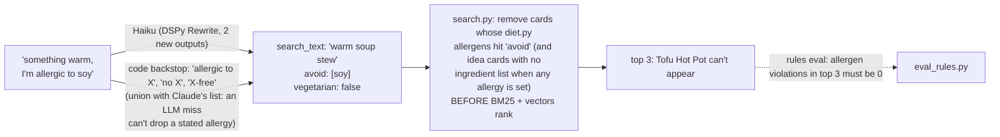

### Filters wired into search (rewrite.py + search.py + evals/eval_rules.py, 2026-11-18)

Rewrite now returns 3 things: search_text, avoid (allergens), vegetarian. Code backstop ("allergic to X", "no X", "X-free")
is UNIONED with Claude's list, so code can only add safety. search.py computes diet fields at load (diet.py) and removes
disallowed cards before BM25 + vectors rank; with any allergy set, idea cards with no ingredient list are removed too (can't prove safe).

Bug found by the search eval: Claude set avoid=[soy] for "something warm WITH tofu" and avoid=[wheat, egg] for "make my own bread or pasta"
-> it listed allergens IN the dish, not the ones to AVOID -> Tofu Hot Pot was filtered out (95% -> 90%).
Fix: field description now says "wanting or mentioning a food is NEVER a reason to avoid it".

| Eval | Before filters | Filters v1 | Filters v2 (fixed instruction) |
|---|---|---|---|
| 20 normal questions, hit@3 | 19/20 (95%) | 18/20 (90%) | **19/20 (95%)** |
| 20 normal questions, precision@3 | 42/60 | 38/60 | **42/60** |
| 8 rule questions: rules read right | - | 8/8 | **8/8** |
| 8 rule questions: violations in top 3 | - | 0 | **0** |

Lesson: adding a safety feature can quietly break normal use; the old eval caught it. Run every eval after every change.
Still missed: "cook once, eat all week" (0/3).

## Grocery-first flow (Andy, 2026-11-18): basket first, recipes second

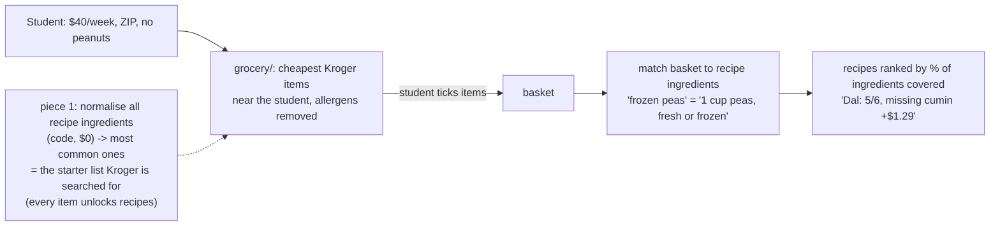

### Grocery piece 1: normalise recipe ingredients (grocery/ingredients.py, $0)

"2 cloves garlic, finely chopped" -> "garlic"; "2 large or 4 medium potatoes" -> "potato" (bug fixed: first version cut at " or " before removing numbers -> None).
95 recipes -> 278 distinct grocery names. Top: garlic 39, butter 30, egg 19, olive oil 17, tomato 16, scallion 16, onion 16, flour 10, sharp cheddar 10.
Open: same food under two names (sharp cheddar / cheese, lemon / lemon juice) -> merge before searching Kroger.
Correction (Andy): the student browses REAL Kroger products as they come; the starter list was not asked for.
ingredients.py stays, but only for the later step: matching the basket to recipe ingredients.

### Kroger browse (DRAFT, before code): what the student sees first

```mermaid
flowchart LR
    S["ZIP 45202 + 'rice, eggs, black beans'"] -->|"token (1 call, reused)"| ST["nearest store<br/>(1 call)"]
    ST -->|"1 call per word, up to 10 products each<br/>(no locationId = no prices)"| P["real products: name, size, regular, promo"]
    P -->|"code parses size: '32 oz' '5 lbr' '12 ct' '1 gal'<br/>best price = promo if any, else regular"| U["unit price: $/lb, $/each, $/fl oz"]
    U -->|"sort cheapest per unit first<br/>(not cheapest sticker: Minute rice on sale was 3x per lb)"| OUT["list the student ticks into a basket"]
```

### Kroger browse: built (kroger/browse.py, 2026-11-18)

Real run, ZIP 45202 -> Kroger On the Rhine (01400513): 3 searches (rice, eggs, black beans), 29 priced products, 4.6 s, 5 API calls, $0.
Cheapest per unit: rice $0.76/lb (Kroger Long Grain 5 lb $3.79), eggs $0.14 each (30 ct $4.19), black beans $0.78/lb (4-can pack on sale $2.99).
Bug found in the output: "4 ct / 15.25 oz" read as 4 items ($0.75/each) and sorted among $/lb prices.
But eggs use the same shape ("12 ct / 24 oz") and must stay per egg.
Fix: read every size both ways ({each, lb}), then use the unit MOST products in that search use (eggs -> each, beans -> lb).

Decision (Andy, 2026-11-18): location is a dedicated input field (ZIP box), NOT asked through the chat.
Why: always present before the first search, validated by code (5 digits, real store found), no LLM needed, can't be misread.
Consequence for Step 11 (interface): needs a UI with form fields next to the chat, which points to a web UI over a plain CLI or Discord.
Decision (Andy, 2026-11-18): interface = Streamlit (picked over Discord: needs real input fields + photos).

### Streamlit screen 1: ZIP + budget -> search -> basket (app.py, 2026-11-18)

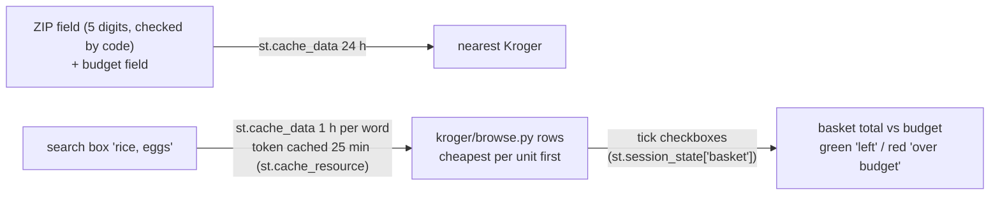

Tested in the browser: ZIP 45202 -> Kroger On the Rhine; "rice, eggs" -> 10 + 10 products; ticked rice $3.79 + eggs 30 ct $4.19
-> "Basket: 2 items · $7.98 of $30.00", "$22.02 left" (matches hand math).
Bug found in the browser: Streamlit reads text between two $ signs as a LaTeX math formula -> prices showed as green code, $ vanished. Fix: escape every $ ("\$").
Run: python3 -m streamlit run app.py (launch config: .claude/launch.json, port 8502).

### Basket -> recipes (DRAFT, before code)

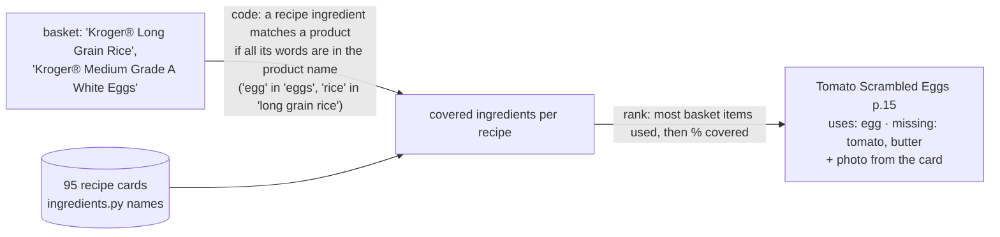

### Basket -> recipes: built (grocery/match.py + app.py section 4, 2026-11-18, $0)

Match rule (code): a recipe ingredient is covered if all its words are in a basket product's name (plurals folded: eggs -> egg).
Rank: most basket products used, then highest share of the recipe's ingredients covered. Top 5, each with its book photo.
Terminal test, basket rice + eggs: Fresh Pasta p.140 (egg; missing flour, olive oil), Tomato Scrambled Eggs p.15, Savory Oatmeal p.31, Rainbow Rice p.144, Omelette p.17.
Basket beans + rice + onions: Salsa p.163, Cabbage Rolls p.109, Vegetable Jambalaya p.96 (2 basket items each).
Browser test: ticked rice + eggs -> "Recipes you can make with your basket" shows photo + title + page + book price + have / still need.
Rough edges: noisy names ("bay leave", "butter for the pan"); no diet filter in the UI yet; missing items not priced at Kroger yet.

## Stage 8: the agent, LangGraph (DRAFT, before code). Natural language enters HERE.

Decision (Andy, 2026-11-18): LangGraph (picked over a raw tool loop). Everything built so far becomes a tool.

```mermaid
flowchart LR
    F["fields (code, no LLM):<br/>ZIP 45202, budget $25"] --> S
    U["student sentence:<br/>'broke till Friday, no peanuts,<br/>tired of rice, something warm'"] --> S[("state: messages, zip, budget,<br/>store, avoid, vegetarian, basket")]
    S --> A["agent node: Claude reads the sentence,<br/>decides which tools to call"]
    A -->|"tool calls"| T["tools node (code = facts and prices)<br/>search_kroger(terms) -> browse.py<br/>find_recipes(text, avoid, veg) -> search.py + diet.py<br/>recipes_for_basket(items) -> match.py<br/>recipe_details(title) -> card steps (follow-ups)"]
    T -->|"results"| A
    A -->|"no more tool calls"| OUT["answer in plain English;<br/>every $ and page number came from a tool"]
```

### Agent piece 1: 4 tools (agent/tools.py, 2026-11-18, $0 - no Claude yet)

| Tool | Wraps | Claude sees args | Direct test |
|---|---|---|---|
| search_kroger | kroger/browse.py | terms (store comes from state via InjectedState, hidden from Claude) | rice -> Kroger Long Grain Rice 5 lb $3.79 ($0.76/lb) |
| find_recipes | recipes_rag/search.py + diet.py | text, avoid, vegetarian | "warm soup", avoid soy, veg -> French Onion Soup p.38, Dal p.35, Butternut Squash Soup p.40 |
| recipes_for_basket | grocery/match.py | items | rice + eggs -> Fresh Pasta, Tomato Scrambled Eggs, Savory Oatmeal |
| recipe_details | recipe cards | title | Dal -> p.35, $0.6/serving, steps; unknown title -> {"error": ...} (not a crash) |

Decision: the store id is injected from state, not a tool argument, so Claude can't call the wrong store. Tool results are trimmed (5 products, short card fields) to keep tokens down.
Load time 11 s (MiniLM model + 125 cards), once per process.

### Agent piece 2: LangGraph loop, first real run (agent/graph.py, 2026-11-18)

Added a 5th tool, check_budget(prices): code adds the prices and compares with the budget (state), so Claude never does math.
Graph: START -> agent (Claude Opus 5.5 + 5 tools) -> tools_condition -> tools (ToolNode, injects state) -> agent ... -> END.

Run: ZIP 45202, $25, "I'm broke till Friday, no peanuts, tired of rice, want something warm"

| # | Claude's tool call |
|---|---|
| 1-2 | find_recipes("warm cheap soup or stew, no rice", avoid=[peanut]) then a 2nd search for bean/lentil/potato |
| 3-4 | recipe_details(Corn Soup), recipe_details(Dal) |
| 5 | search_kroger(11 items: lentils, frozen corn, onion, potatoes, ...) |
| 6 | check_budget(11 prices) -> over budget |
| 7 | check_budget(10 prices, celery dropped) -> $22.60, $2.40 left |

Answer: Dal p.35 + Corn Soup p.36, 10 Kroger items with real prices, total $22.60 of $25 (hand check: correct),
said it dropped celery to stay in budget and that spices weren't priced. Every number came from a tool.
Cost: 6 Claude calls, 29,695 in / 1,577 out tokens = $0.15 per answer, 28.2 s. Too slow/expensive for a student app -> next: cost levers.

### Agent piece 3: Opus orchestrates, Haiku answers + prompt caching (Andy's design, DRAFT)

```mermaid
flowchart LR
    S[("state")] --> O["orchestrator: Opus 5.5 + tools<br/>(cache_control: re-reads earlier turns at $0.20/M)<br/>decides which tools to call"]
    O -->|"tool calls"| T["tools (code)"]
    T --> O
    O -->|"says READY (no answer text)"| H["respond: Haiku 5.5, no tools<br/>writes the student answer from tool results<br/>($0.10 in / $0.50 out per M)"]
    H --> E[END]
```
Expected: the answer is 1 of ~6 calls, so this split alone saves only its output tokens; caching is the bigger lever. Measured per model below.

Run (same sentence, 2026-11-18): Opus orchestrates with caching, Haiku answers.

| | Opus does everything (piece 2) | Opus + caching, Haiku answers (piece 3) |
|---|---|---|
| Opus | 6 calls, 29,695 in, 1,577 out = $0.1503 | 6 calls, 30,319 in (22,237 from cache), 920 out = $0.0552 |
| Haiku | - | 1 call, 5,984 in, 1,888 out = $0.0015 |
| total / time | **$0.1503** / 28.2 s | **$0.0567** (-62%) / 28.8 s |
| answer quality | correct: items, total $22.60 matched | WORSE: listed prices that weren't the ones Opus totalled (frozen corn $1.29 vs $3.19, celery $2.49 vs $3.00) and said "I can't confirm which items are in the $24.30" |

Most of the saving came from caching (22k of 30k Opus input tokens re-read at $0.20/M instead of $4/M); the Haiku split saved Opus's ~650 answer tokens.
Quality bug: under investigation (Andy to guess the cause first).

### Per-call trace: did we match tasks to models? (rerun, 2026-11-18, $0.0717)

| # | Model | Job | In (cached) | Out | $ |
|---|---|---|---|---|---|
| 1 | Opus | find_recipes | 1,266 (0) | 87 | 0.0068 |
| 2 | Opus | find_recipes + 2x recipe_details | 1,595 (1,262) | 211 | 0.0058 |
| 3 | Opus | recipe_details | 3,922 (1,593) | 98 | 0.0116 |
| 4 | Opus | search_kroger (14 words) | 4,664 (3,920) | 196 | 0.0077 |
| 5 | Opus | READ 70 products, pick + check_budget | 9,747 (4,662) | 374 | **0.0288** |
| 6 | Opus | check_budget again (trim) | 10,160 (9,745) | 145 | 0.0065 |
| 7 | Opus | said "READY" (4 tokens) | 10,344 (10,158) | 4 | 0.0029 |
| 8 | Haiku | wrote the answer from 70 products | 8,065 | 1,784 | 0.0017 |

Verdict:
- Opus 1-6 = judgment (which recipes, which products, what to drop): right model. Call 7 = a wasted round trip just to say READY.
- Haiku 8 was meant to only WRITE, but the handoff gave it 70 products and only Opus's PRICE list, so it re-did Opus's job (picking products) and got it wrong:
  it listed celery $2.49 / lentils $1.25 / ginger $2.49 (Opus used $3.00 / $1.49 / $1.99) and said total $23.80 (copied from check_budget),
  but its own listed items add up to $22.06. The student would see a total that doesn't match the list.
Root cause: the handoff carried raw facts, not Opus's DECISIONS.

### Agent piece 4: re-match jobs to models (Andy, DRAFT)

Calls 1-4 (search the cookbook, read recipes, search Kroger) are fetching, not judgment -> Haiku.
Picking products + trimming to budget + writing the answer belong together (the handoff bug came from splitting them) -> Opus.

```mermaid
flowchart LR
    S["student sentence"] --> G["gatherer: Haiku 5.5<br/>tools: find_recipes, recipe_details, search_kroger<br/>says DONE when it has the facts"]
    G -->|"tool calls"| GT["gather tools (code)"] --> G
    G -->|"DONE: bundle = sentence + every tool result"| P["planner: Opus 5.5<br/>tool: check_budget only<br/>picks products, trims to budget, WRITES the answer"]
    P -->|"check_budget"| PT["code adds prices"] --> P
    P --> E[END]
```

Run (same sentence, 2026-11-18): Haiku gathers, Opus decides + writes.

| # | Model | Job | In (cached) | Out | $ |
|---|---|---|---|---|---|
| 1 | Haiku | 3x find_recipes (in parallel) | 949 (0) | 343 | 0.0003 |
| 2 | Haiku | 3x recipe_details | 2,081 (945) | 355 | 0.0003 |
| 3 | Haiku | search_kroger (11 words) | 4,786 (2,079) | 299 | 0.0004 |
| 4 | Haiku | said DONE | 10,259 (4,784) | 5 | 0.0006 |
| 5 | Opus | read the bundle, pick products, check_budget (over by $1.61) | 8,864 (0) | 1,337 | **0.0622** |
| 6 | Opus | drop lemon, check_budget -> $23.62 | 10,240 (8,860) | 157 | 0.0104 |
| 7 | Opus | wrote the answer | 10,436 (10,238) | 544 | 0.0137 |

| Version | $ / answer | Time | Answer correct? |
|---|---|---|---|
| piece 2: Opus does everything | 0.150 | 28 s | yes |
| piece 3: Opus gathers + decides, Haiku writes | 0.057-0.072 | 29-35 s | NO (list didn't match total) |
| piece 4: Haiku gathers, Opus decides + writes | **0.088** | 38 s | **yes**: 10 items listed = the 10 prices totalled, $23.62 (hand check matches) |

Gathering on Haiku cost $0.0016 for 4 calls. Opus is now 98% of the bill, mostly call 5: 8,864 uncached tokens of facts
(5 products per word x 11 words + full recipe steps) and 1,337 output tokens of thinking.
Next levers: trim the bundle (2 products per word, ingredients not steps) and lower Opus effort.

### Shrink what Opus reads (agent/graph.py compact(), 2026-11-18)

compact(): 2 cheapest products per search word (was 5), recipe ingredients without cooking steps, JSON without spaces.

| | piece 4 | piece 4 + compact bundle |
|---|---|---|
| Opus call 5 input (uncached) | 8,864 | **4,284** (-52%) |
| Opus calls 6-7 input | 10,240 / 10,436 | 5,549 / 5,706 |
| Haiku (4 calls) | $0.0016 | $0.0015 |
| total / time | $0.0880 / 38 s | **$0.0625** / 38 s |
| answer correct? | yes ($23.62) | yes: 10 items = $24.67, hand check matches |

Side effect seen (quality, not math): with only 2 options per word, Opus bought canned "Brown Sugar Hickory Baked Beans" to MAKE baked beans,
and left cumin / turmeric / green chili unpriced ("Kroger only showed products that don't fit"). Fewer tokens = fewer choices.
Opus still thinks for ~1,200 output tokens on call 5 ($0.025). We now need an agent eval to judge trade-offs like this (cheaper vs worse picks).

## Agent eval (DRAFT, before code): judge cost vs quality on 10 student sentences

```mermaid
flowchart LR
    C[("10 cases: sentence, budget,<br/>rules (avoid, vegetarian)<br/>ZIP 45202")] --> A["agent/graph.py<br/>(the version under test)"]
    A --> K["code checks per answer (no LLM judge):<br/>1 within budget (last check_budget)<br/>2 answer total = check_budget total, every priced item listed<br/>3 every $ in the answer came from a tool result<br/>4 recommended recipes respect avoid / vegetarian (diet.py)<br/>5 every 'p. N' cited is the recipe's real page"]
    A --> M["$ and seconds per answer"]
    K --> S["pass rate per check + $ per answer<br/>-> compare versions (bundle 5 vs 2 products, effort, models)"]
```

### M6: run_evals.py + agent eval baseline (2026-11-18)

run_evals.py = one command: 4 free component evals (~30 s) + `--agent` for the paid end-to-end eval.
Component evals: extraction 34/34 | search hit@3 75% raw, 95% with rewrite | allergen recall 55/55 | rules 8/8, 0 violations.

Agent baseline, first try: CRASHED. Kroger /products returned an error with no "data" field (3 cases at once x ~11 searches
= too many requests) -> KeyError killed all 10 cases.
Fixes: browse.py retries 429/5xx (1, 2, 4 s or Retry-After); search_kroger returns {"error"} to Claude instead of crashing;
the eval records a crashed case as FAIL and continues; 2 cases at a time.

Agent baseline, second try ($0.571 for 10 cases):

| Check | Score |
|---|---|
| 1 within budget | 10/10 |
| 2 total + items match | 10/10 |
| 3 every $ from a tool | 9/10 -> 10/10 after fixing an EVAL bug: "$1.38 over" came from check_budget's "left": -1.38; the check ignored minus signs |
| 4 diet respected | 10/10 |
| 5 pages real | 10/10 |
| cost / time per answer | **$0.057** (range $0.045-0.070), ~35 s (27-44 s) |

Charter targets: quality met (10/10); cost $0.057 vs target $0.05; time ~35 s vs target 30 s -> M7.

### M7 lever B: Sonnet 5.5 as the planner (PLAN_MODEL setting, 2026-11-18, eval $0.281)

| | Opus planner (baseline) | Sonnet planner |
|---|---|---|
| all 5 checks | 10/10 | 6/10 |
| $ per answer | 0.057 | **0.028** (-51%) |
| time per answer | ~35 s | ~30.5 s (21-45 s) |

The 4 failures, read one by one:
- 3x "made up $": Sonnet MULTIPLIED in its head ("2 cans at $2.59 each: $5.18", "$0.69 each, $1.38 total").
  The arithmetic is right, but it breaks the rule "code does the math"; check_budget only takes a flat price list, so line subtotals
  had nowhere to come from. Opus avoided this; Sonnet doesn't. Fix in the TOOL (model-agnostic): check_budget takes quantities and returns line totals.
- 1x "diet violated": an EVAL bug. Sonnet wrote "I skipped Black-Eyed Peas and Collards ... showed egg"; the eval counted any
  mentioned title as recommended. Fix: a recipe counts as recommended only if its page is cited too.
Also seen: Sonnet recommended "And Mine (p.101)", a title fragment from extraction (the Baked Beans variation), = card-quality debt.

### M7 done: Sonnet planner + check_budget with quantities (2026-11-18, eval $0.289)

Fixes: check_budget(items=[{name, price, quantity}]) returns line totals computed by code (2 x $2.59 = $5.18);
planner told to quote them; eval counts a recipe as recommended only if its page is cited (title alone = "I skipped X").

| | Opus planner (baseline) | Sonnet v1 | **Sonnet v2 (fixed tool + eval)** | Charter target |
|---|---|---|---|---|
| all 5 checks | 10/10 | 6/10 | **10/10** | 10/10 |
| $ per answer | 0.057 | 0.028 | **0.029** | <= 0.05 |
| time per answer | ~35 s | ~30.5 s | **~27.8 s** (17-35 s) | < 30 s |

Default planner is now claude-sonnet-5-5 (PLAN_MODEL env var switches back to Opus).
Lessons: the cheaper model exposed a tool-design gap (no way to get code-computed line totals) that Opus papered over;
fixing the tool, not the prompt, made the cheap model pass. Two of the four v1 "failures" were real, one was an eval bug, and
the eval was fixed only where it was provably wrong (Sonnet wrote "I skipped ...").
Caveats: one run of 10 cases (1 case = 10 points); Opus not re-run with the new tool; card-quality debt: "And Mine (p.101)" title fragment.

## M8: the agent in Streamlit (DRAFT, before code)

```mermaid
flowchart LR
    SB["sidebar fields (code, no LLM):<br/>ZIP (5 digits -> nearest Kroger)<br/>weekly budget"] --> ASK
    ASK["tab 'Ask': chat box<br/>'broke till Friday, no peanuts...'"] -->|"app.invoke(sentence, location_id, budget)<br/>Haiku gathers -> Sonnet decides + writes"| ANS["answer (every $ escaped: Streamlit reads $..$ as math)"]
    ANS --> PH["recipe photos: cards whose title AND page<br/>appear in the answer (same rule as the eval)"]
    ANS --> HOW["expander 'how I got this':<br/>tool calls, $ and seconds"]
    SB --> BR["tab 'Browse': screen 1 as before<br/>(search, tick, basket, basket recipes)"]
```
Each chat message is one fresh agent run (no follow-up memory yet).

### M8 done: the agent in Streamlit (app.py, 2026-11-18)

Layout: sidebar = ZIP (checked by code -> Kroger On the Rhine) + budget; tab "Ask" = chat with the agent; tab "Browse Kroger" = screen 1.
Browser test (new sentence, not in the eval): ZIP 45202, $25, "vegetarian, no peanuts, I want something spicy I can eat all week"
-> Dal p.35 + Spicy Green Beans p.59 with their cookbook photos, 9 Kroger items, total $23.57 (hand check: correct), $1.43 left,
no $ display bug (every $ escaped), "How I got this": 7 tool calls, $0.031, 30 s.
Photos: only recipes whose title AND page are in the answer (same rule as the agent eval). Each message = one fresh agent run.

### M11 research: where nutrition comes from (2026-11-19, $0, nothing invented)

| Source | What it has | Checked |
|---|---|---|
| **Kroger product API** (same call we already make) | `nutritionInformation`: serving size, servings per package, 15-22 nutrients (protein, calories, fat, fiber, sodium...), ingredient statement; `allergens` with "Contains" / "Free from" / "May contain" | protein on 25 of 30 products (lentils, eggs, beans, rice, chicken, zucchini); missing on 5 (e.g. Bush's beans, zucchini trays) |
| USDA FoodData Central (key in .env) | generic foods per 100 g ("lentils, raw") | returned HTTP 502 today (worked on 2026-11-17) |
| Open Food Facts (by UPC) | branded products | Kroger lentils UPC 0001111089654: not found |

Note: printing only allergen NAMES looked alarming (rice listing "fish, peanuts"); the entries carry levelOfContainmentName and most say "Free from".
Idea: protein per package = protein per serving x servings per package (e.g. 18 eggs x 6 g = 108 g), computed by code from Kroger's own label data.

### M11: nutrition from Kroger labels (picked A over USDA per recipe, DRAFT)

```mermaid
flowchart LR
    K["Kroger product (same call as prices)<br/>label: protein/serving, servings/package"] -->|"browse.py: code multiplies<br/>9 g x 13 servings = 117 g per bag"| R["product row + nutrition"]
    R -->|"search_kroger shows protein per package<br/>+ protein per $ (code)"| P["planner (Sonnet)"]
    T["sidebar toggle 'High protein'<br/>(state, not chat)"] --> P
    P -->|"check_budget(items)"| C["code: total $, AND total protein /<br/>calories / fiber for the week, per day"]
    C --> A["answer: '$23.40, 312 g protein (45 g/day)'<br/>numbers only from check_budget"]
```

### M11 built: nutrition from Kroger labels + high-protein toggle (2026-11-19)

browse.py nutrition(): label per-serving x servings per package (12/12 products in the test; dry lentils 126 g protein for $1.49 = 85 g/$, canned 19 g/$).
search_kroger shows protein_g + protein_per_dollar; check_budget adds protein / calories / fiber for the week + protein per day + "no_label" items.
Sidebar toggle "High protein" -> state.high_protein -> planner prompt (favour protein per $, aim >= 60 g/day).
Same request ("vegetarian, cheap dinners for the week", $25): OFF 2 recipes, $16.74, 33 g/day; ON 3 recipes, $22.61, 69 g/day.
Component evals unchanged. Agent eval 8/10 ($0.263):
- "cheapest dinners": Sonnet wrote "adding butter, garlic and ginger would bring the total to $15.84" = a what-if sum done in its head (rule break; fix: what-if totals must come from check_budget too).
- "sweet breakfast": CRASHED with HTTP 400 "Your credit balance is too low to access the Anthropic API" = billing, not code. All paid runs blocked until credits are added.
Recipes per answer: 2-3 pages cited in every completed case (M10 lead: "only one recipe" not reproduced by the eval sentences).

### M11b design: recipe nutrition from USDA (2026-11-19)

Facts checked first: USDA key works (FDC_API_KEY, "Lentils, raw" per 100 g: 352 kcal, 24.6 g protein, 63.4 g carbs, 10.7 g fiber, 2.03 g sugar).
Kroger labels (39 products): Protein 37, Total Carbohydrate 36, Dietary Fiber 36, Calories 37, Sugar 36 -> all 5 available for groceries too.

```mermaid
flowchart LR
    C["95 recipe cards<br/>'4 eggs', '1 cup dry lentils'"] -->|"code parses amount + unit + food<br/>WHY: USDA has portions (1 cup lentils = 192 g);<br/>rejected: Haiku for grams. Salt/pepper/spices = 0"| G["ingredient grams"]
    G -->|"USDA search (Foundation / SR Legacy)<br/>WHY: per-100 g lab data, free; rejected: Claude guessing = made-up numbers"| U["per 100 g: kcal, protein,<br/>carbs, fiber, sugar"]
    U -->|"code: grams/100 x value, sum lines,<br/>divide by servings ('makes')"| N["card.nutrition per serving<br/>(saved in the card JSON, done once)"]
    N --> T["find_recipes shows it; toggles<br/>(high protein, low sugar) filter/rank by code"]
    K["Kroger labels: + carbs, sugar<br/>(already on 36/39 products)"] --> B["check_budget: week totals for all 5"]
```

### M11b built: recipe nutrition, code + USDA, no LLM (2026-11-19)

recipes_rag/nutrition.py + usda_foods.py (87 hand-checked pattern -> exact USDA SR Legacy name) -> data/nutrition.json. 4 min first run, then cached.

| | Run 1: USDA search top hit | Run 2: hand list (usda_foods.py) |
|---|---|---|
| lines counted | 322 | 392 |
| missed | 328 | 230 (146 have no amount, 46 not in list, 38 no matching portion) |
| wrong matches | "2 eggs -> Bagels, egg", "½ cup milk -> Crackers, milk", "1 medium onion = 14 g" | none in a 14-line spot check |

Lesson: search ranks by word overlap ("egg" is in "Bagels, egg"); a hand-checked list of 87 foods beats fuzzy search when the vocabulary is small.
Gotcha: USDA search returns HTTP 400 on ( ) % / in the query -> strip punctuation, still demand the exact name.
Examples: Dal (p.35) per serving 381 kcal, 24 g protein, 65 g carbs, 11 g fiber, 4 g sugar. Omelette (p.17) 126 kcal, 11 g protein.
Servings known for 55/95 recipes ("makes" is empty on the rest) -> those get whole-recipe totals only.

### M11c design: recipe + grocery nutrition into the agent (2026-11-19)

```mermaid
flowchart LR
    N["data/nutrition.json<br/>(USDA, per serving or per recipe)"] -->|"search.py load_cards merges by page|title<br/>WHY: one card object everywhere; rejected: a 6th tool (more calls)"| S["card.nutrition"]
    S -->|"card_summary adds it<br/>(find_recipes, recipes_for_basket, recipe_details)"| P["planner (Sonnet)"]
    K["Kroger label: + carbs, sugar"] -->|"check_budget sums all 5 for the week"| P
    T["High protein toggle"] -->|"prefer recipes with more protein per serving"| P
    P --> A["answer: each recipe's kcal / protein / carbs / fiber / sugar per serving<br/>+ the week's groceries totals (numbers only from tools)"]
```

### M11c built (2026-11-19)
Tools now return nutrition: find_recipes("warm lentil soup") -> Dal p.35 381 kcal / 24 g protein / 65 g carbs / 11 g fiber / 4 g sugar per serving (0 lines uncounted).
check_budget(2 x lentils $1.25) -> week 700 kcal, 48 g protein, 132 g carbs, 20 g fiber, 8 g sugar. Planner rule added: what-if totals only from check_budget.
Component evals unchanged (34/34, 75% -> 95%, allergen 55/55, rules 8/8). Live agent run: blocked, HTTP 400 credit balance too low.

### M13 design: protein goal slider (2026-11-19)

```mermaid
flowchart LR
    S["sidebar slider<br/>Protein goal 0-150 g/day (0 = no goal)"] -->|"state.protein_goal (number, not chat)<br/>WHY: a number the student sets, checked by code;<br/>rejected: on/off toggle (no target), typing it in chat (AI could misread)"| P["planner (Sonnet)"]
    P -->|"check_budget(items)"| C["code: protein_g_per_day vs goal<br/>-> 'goal_met', 'protein_short_g_per_day'"]
    C -->|"short and money left?<br/>swap/add high protein-per-$ items, check again"| P
    C --> A["answer: '62 of 80 g/day' exactly as check_budget said"]
```

### M13 built (2026-11-19)
Slider 0-150 g/day -> state.protein_goal -> check_budget adds protein_goal_g_per_day, goal_met, protein_short_g_per_day (code).
Same question in the app ("vegetarian, cheap dinners for the week, I want to build muscle", $25):

| | toggle ON (before) | goal 80 g/day (after) |
|---|---|---|
| protein per day | 40 g (goal not mentioned) | 83 g, "goal met" |
| lentil bags | 1 | 4, + 3 cans chickpeas |
| total / left | $19.46 / $5.54 | $24.60 / $0.40 |

### M14 design: click a recipe -> full recipe pop-up (2026-11-19)

```mermaid
flowchart LR
    A["answer cites Dal p.35, Rainbow Rice p.144"] -->|"cited_recipes(): title AND page cited (same rule as eval)"| C["recipe cards under the answer<br/>photo + title + protein + 'View recipe' button"]
    C -->|"click -> st.dialog pop-up<br/>WHY: opens over the chat, chat stays put;<br/>rejected: expander (pushes the chat down)"| D["full card from search.cards (page + title)<br/>big photo, nutrition tiles, ingredients, steps"]
```
No LLM call: the pop-up reads the saved card, so opening a recipe is free and instant.

### M14 built (2026-11-19)
app.py: recipe_cards() under each answer (photo, title, kcal + protein, "View recipe") -> show_recipe() st.dialog pop-up
(photo beside 5 nutrition tiles, ingredients left, steps right). Reads the saved card: $0, no LLM call.
Checked in the browser: Dal p.35 and Spinach and Chickpea p.73 open with photo, nutrition, ingredients, steps.
First try: photo full width filled the pop-up -> moved beside the numbers.

### M11 finished: 2 small fixes, agent eval back to 10/10 (2026-11-19)
- "And Mine" (p.101) = the author's own baked beans after her dad's (p.100) -> TITLE_FIXES in search.py -> "Baked Beans from Scratch".
  Its nutrition missed the beans (pinto not in usda_foods.py): 82 kcal / 1 g protein -> 446 kcal / 24 g protein per serving after adding pinto + kidney.
- Planner: quantity > 1 is written "$1.09 x 2 = $2.18".
- Also since the last eval: Browse groups each food (best value + "see N more"), quick-pick staples, recipe pop-up, protein slider.
Agent eval m14_fixes: 10/10 on all 5 checks, $0.0334 per answer, ~27 s.

| eval run | all 5 checks | $ per answer |
|---|---|---|
| m11_nutrition | 8/10 (credits ran out + what-if total) | $0.026 |
| m11c_nutrition | 9/10 (menu card with same title) | $0.032 |
| m11d_cookable | 9/10 (unit price missing for qty 2) | $0.032 |
| m14_fixes | 10/10 | $0.033 |

### Unit tests for the plain code (2026-11-19)
tests/test_nutrition.py: 27 tests, 0 LLM calls, $0, ~9 s (reads the saved USDA cache; USDA tests skip if it's missing).
Covers: parse (ranges, "or", no amount), grams (1 cup lentils 192 g, 1 medium onion 110 g, 4 eggs 176 g),
food match (eggs -> "Egg, whole, raw" not bagels), servings text, Kroger label x servings, check_budget math
(1.09 x 2 = 2.18, protein 294 g = 42 g/day, goal short 38 g), cookable cards.
run_evals.py runs them first. Rule: evals for the AI parts (scores), unit tests for code (pass/fail).
Added 12 more (39 total, ~10 s, still 0 API calls): recipe totals / servings, Kroger size parsing, browse() sorting on a fake
Kroger response, search_kroger protein-per-$ + error result, recipe_details on duplicate titles, find_recipes cookable-only.
Coverage before -> after: tools.py 66% -> 95%, browse.py 34% -> 67%, nutrition.py 57% -> 74%.
What's left uncovered is network code (token, nearest store, USDA/Kroger fetch) and the __main__ scripts.

### M12 design: Ask tab at a glance (2026-11-19)

```mermaid
flowchart TB
    O["agent output"] -->|"last check_budget ToolMessage (code numbers)"| T["tiles: total of budget | protein/day vs goal | recipes | items"]
    O -->|"cited_recipes()"| C["recipe cards + View recipe pop-up"]
    O -->|"check_budget lines"| L["shopping table: product, qty, price, line total, protein"]
    O -->|"Sonnet's text, collapsed<br/>WHY: numbers already shown by code; text keeps notes (unpriced items)<br/>rejected: shorter prompt (eval check 2 reads prices in the text)"| W["Full write-up (expander)"]
```

### M12 built: Ask tab at a glance + Kroger token fix (2026-11-19)
Tiles (from the last check_budget, code numbers): Total $24.40 (+$0.60 left) | Protein/day 39 g (goal 80, -41 g) | 2 recipes | 7,395 kcal.
Then recipe cards, a shopping table (product, qty, price, line total, protein), the AI's text folded in "Full write-up".
Bug found while testing: HTTP 401 on every Kroger call after the app ran > 30 min. tools.kroger_headers() fetched a token once
and kept it forever; Kroger tokens die at 30 min. Fix: renew after 25 min (+ unit test with a fake clock; 40 tests pass).
The agent handled the 401 honestly: no prices invented, no budget check, said so.
Open: Kroger has 2 sizes named "Kroger Pinto Beans"; _labels is keyed by name, so check_budget can read the wrong size's label (91 g vs 182 g).

### Servings from pieces and cups (2026-11-19)
servings() now returns (count, unit) from the book's own "makes" words: "twenty-four small muffins" -> (24, muffin),
"makes four pizzas" -> (4, pizza), "three and a half cups" -> (3.5, cup), "serves four to six" -> (4, serving).
Recipes with a usable count: 55 -> 77 of 95. The 18 with no "makes" text stay "whole recipe" (Andy: leave them out, no guessing).
Example: Chocolate Zucchini Muffins p.21 = 132 kcal, 3 g protein per muffin (makes 24). 46 unit tests pass.
Diagnosed, not fixed yet: check_budget trusts the name + price Claude types; same-name products (3 pinto bean sizes, 4 egg sizes;
7 of 77 products) read the wrong label. Planned fix: product IDs from search_kroger; code looks up price + label.
Idea from Andy, not built yet: protein per day from recipe servings eaten, not from groceries bought.

### Product IDs: code owns every price (2026-11-19)

Before: Claude types name + price; code trusts both.
```mermaid
flowchart LR
    S1["search_kroger"] -->|"name, size, price"| C1["Claude"]
    C1 -->|"check_budget(name='Kroger Pinto Beans', price=2.29)<br/>typed by Claude, never checked"| B1["check_budget: label by NAME<br/>3 sizes share it -> wrong label (91 vs 182 g)"]
```
After: Claude passes only IDs + quantities; code looks everything up.
```mermaid
flowchart LR
    S2["search_kroger"] -->|"id = Kroger productId (unique per size)<br/>saved in _products: name, size, price, label"| C2["Claude"]
    C2 -->|"check_budget(id='0001111087613', qty=2)<br/>WHY: a typo = 'unknown id' error, never a wrong price;<br/>rejected: name + size key (Claude still types prices)"| B2["check_budget: price + label by ID from _products"]
```

### M16 design: the final answer is a JSON plan, checked by code (2026-11-19)

Before: the plan lived in prose; eval + app guessed it ("last check_budget call", regex for $ and pages) -> 8/10.
```mermaid
flowchart LR
    P["planner (Sonnet)"] -->|"check_budget(ids, qty): what-ifs, as often as it likes"| B["code: prices + totals"]
    B --> P
    P -->|"submit_plan(Plan JSON)<br/>recipes: title, page, batches | items: id, qty | avoid, vegetarian | note<br/>WHY: one decided object, schema-enforced;<br/>rejected: 'last check_budget is final' prompt rule (still a guess)"| V{"code validates:<br/>ids known? pages real + cookable?<br/>total <= budget? no avoided allergens?"}
    V -->|"problems -> back to planner"| P
    V -->|"accepted -> END"| F["final plan JSON"]
    F --> A["app: tiles, cards, table, note"]
    F --> E["eval: reads fields, no regex"]
```

### M16 built: JSON plan via submit_plan (2026-11-19)
tools.py: Plan(recipes[title, page, batches], items[id, qty], avoid, vegetarian, note) + submit_plan: code rejects unknown ids,
fake/menu-card pages, over-budget totals, avoided allergens / meat for vegetarians, and sends the problems back to Claude.
graph.py: planner tools = check_budget (what-ifs) + submit_plan; the graph ENDS on an accepted plan; final_plan(out) is the one reader.
Eval reads plan fields (no regex over prose). App renders tiles, cards, table from the plan; note = Claude's only words.

| run | all 5 checks | $ / answer | why it failed |
|---|---|---|---|
| m15_ids (prose answer) | 8/10 | $0.035 | eval + tiles read the LAST check_budget, which was a dropped what-if |
| m16_json_plan | 10/10 | $0.030 | - |
57 unit tests pass (8 new submit_plan cases). Browser: "sweet breakfast, I hate oatmeal" -> $22.98 of $25, 41 g/day, 2 recipes.
Tiles moved to 2 x 2: 4 in a row cut off the numbers in a narrow window.

### M17 design: nutrition from what you EAT (recipes x batches), not what you BUY (2026-11-20)

| | bought (Kroger labels, today) | eaten (recipes x batches, new) |
|---|---|---|
| 5 cans red beans | 140 g protein, all counted | only what the recipes use |
| 32 oz brown sugar | the whole bag | 2 tbsp |

```mermaid
flowchart LR
    P["Plan: Dal p.35 x 2 batches,<br/>Corn Soup p.36 x 1"] -->|"code: recipe total (USDA) x batches<br/>WHY: counts food eaten; rejected: grocery labels (leftovers count as eaten)"| W["week: kcal, protein, carbs, fiber, sugar<br/>/ 7 = per day"]
    P -->|"servings x batches (recipes that say 'for four')"| M["meals covered: 8 + 4 = 12 servings"]
    W --> G["protein goal check: eaten g/day vs slider"]
    L["Kroger labels"] -.->|"kept as a side fact: 'groceries hold X g'"| T["tiles"]
    W --> T
    M --> T
```

### M17 built: nutrition eaten = recipe totals x batches (2026-11-20)
submit_plan adds eaten_week / eaten_per_day / servings_planned; protein goal checked on eaten. Tiles: protein eaten/day,
servings planned (Dal x2, Rainbow Rice x2 = 12), kcal eaten/day. Grocery-label protein shown as a side note. 59 tests pass.
Agent eval m17_eaten: 10/10, $0.036 per answer (was $0.030: the planner now also picks batches).
What the 10 plans show (eaten vs bought, per day):
- bought protein is 1.2x-2.8x eaten (gluten free: 98 g bought vs 35 g eaten) -> the old number counted leftovers.
- eaten 290-1,083 kcal/day; servings planned 4-18 -> plans cover a few meals, not a week of eating (~2,000 kcal/day).
- "Baked Beans from Scratch" is in 6 of 10 plans.

### Tests + eval gaps closed (2026-11-20)
Unit tests 59 -> 76: graph.py routing + final_plan + compact (was 0%), basket matching, and the real app.py rendered by
Streamlit AppTest with a saved plan (tiles show eaten 27 g, not bought 72 g). Routing lambdas -> named functions to test them.
Eval: 2 protein-slider cases (10 old cases unchanged), check 3 now also catches nutrition numbers in the note,
measures kcal/protein eaten per day, servings, rejected plans, goal met.
Baseline m18_baseline_week (12 cases): 11/12 all checks, $0.035/answer. Week coverage median 599 kcal/day (183-1,402),
median 10 servings, 0 rejected plans, protein goal met 0/2 (97 of 100 g, 70 of 80 g).
Fail: "vegetarian and I want lots of protein" note said "30 g", "80 g", "$6" (rule: no numbers in the note).

### M18 design: the plan must cover the week (code enforces) (2026-11-20)

```mermaid
flowchart LR
    P["Plan: meals = [lunch, dinner]<br/>Dal x2, Rainbow Rice x2"] -->|"target = 7 x 2 = 14 meals"| T["target"]
    P -->|"meals per batch: 'for four' -> 4;<br/>pieces / unknown -> whole kcal / 600<br/>WHY: no guessed portions; rejected: count only 'for N' (pancakes = 0 meals)"| M["meals planned: 8 + 4 = 12"]
    T --> V{"12 >= 14?"}
    M --> V
    V -->|"no, and money left (total < 90% of budget)<br/>-> reject: 'covers 12 of 14 meals: add batches or a cheap filling recipe'"| P
    V -->|"no, but budget used (>= 90%) -> accept, flag budget_limited"| C
    V -->|"yes -> accept"| C["code lays out Mon-Sun calendar<br/>(meal slots filled recipe by recipe)"]
    C --> U["app: week calendar"]
```
Andy picked A (enforce) over B (report only): the mission promises a week of meals.

### M18 built: week coverage enforced (2026-11-20)
Plan.meals (default lunch + dinner) -> target 7 per meal type; meals_from: "for four" x batches, else whole kcal / 600;
submit_plan rejects a short week while < 90% of the budget is spent; code lays out a Mon-Sun calendar. 81 tests pass.

| 12 cases | m18 baseline | m19 week enforced |
|---|---|---|
| all 5 checks | 11/12 | 12/12 |
| week covered (meals planned >= target) | not measured | 12/12 (0 needed "budget ran out") |
| kcal eaten / day | median 599 (183-1,402) | median 908 (436-1,933) |
| protein goal met | 0/2 | 1/2 (116 of 100 g; vegetarian 59 of 80 g) |
| $ / answer | $0.035 | $0.037 |
Planner read meals right: "lunches I can carry" -> lunch only; "breakfasts and dinners" -> both; "dinners" -> dinner.
Rejected plans: 0 -> the prompt rule did the work, code is the backstop. A "for four" serving counts as a meal even
when it's a light dish, so kcal/day (~450 per meal) is still below ~2,000/day.

### M19 design: FastAPI + React replaces Streamlit (2026-11-20)

```mermaid
flowchart LR
    R["React page (web/)<br/>ZIP, budget, protein slider, chat box"] -->|"GET /api/store?zip=45202"| F["FastAPI (api/main.py)"]
    R -->|"POST /api/plan {sentence, zip, budget, goal}"| F
    F -->|"app.stream(...): each node as it finishes<br/>WHY: student sees progress; rejected: one 30 s spinner"| G["LangGraph agent (agent/, unchanged)"]
    F -->|"events: 'Searching recipes...', 'Checking prices...',<br/>then the final plan JSON"| R
    R --> V["tiles, Mon-Sun calendar, recipe cards + pop-up,<br/>shopping table: all from the plan JSON"]
    F -->|"GET /api/products?term=rice"| K["kroger/browse.py (Browse tab)"]
    F -->|"GET /images/p35_1.png"| I["recipe photos"]
```
Nothing in agent/, kroger/, recipes_rag/ changes: the API wraps the same functions app.py calls.
Andy picked: stream steps (server-sent events) + Vite + React + TypeScript (rejected Next.js: two servers, more than needed).

### M19 built: FastAPI + React (2026-11-20)
api/main.py (FastAPI): /api/store, /api/plan (server-sent events: one 'step' per tool call, then 'plan' or 'error'),
/api/products, /api/recipe, /images. Same agent/ and kroger/ code; nothing in them changed.
web/ (Vite + React + TypeScript): sidebar (ZIP, budget, protein slider), "Plan my week" with live steps, tiles,
Mon-Sun calendar, recipe cards + pop-up, shopping table, plan JSON; Browse tab with staples, grouped products, basket.
Browser check: steps streamed live ("Searching the cookbook 2s" ... "Checking prices at your Kroger 6s"), then the plan:
$24.52 of $25, 24 of 7 dinners, 83 g protein eaten/day (goal 80, met). Phone width 375 px: no sideways scroll.
Bugs found while checking: blank page (useEffect returned scrollIntoView's Promise -> "destroy is not a function");
page scrolled sideways (grid column needed min-width: 0); tall photo hid the recipe (max-height).
Tests: 6 API tests with a fake agent (SSE order, validation, error events) -> 87 pass.

### M20: premium "Fresh market" UI (2026-11-20)
Andy picked: Fresh market look (cream, tomato / avocado / saffron, Fraunces serif) + animated agent timeline +
rings with count-up numbers + tick-off shopping list (remembered in browser storage). Rejected: dark premium, photo calendar.
Built: header bar with ZIP / budget stepper / protein slider; start screen with 4 one-click example requests;
5-stage timeline (read -> cookbook -> Kroger -> pricing -> checks) lighting up from the SSE steps, collapsing to
"Planned in 29 s · 9 steps · $0.034"; hero with 3 rings (99% of budget, 16/7 meals, 50 g of 80 protein); colour-coded
Mon-Sun chips (click = recipe); photo cards with hover lift; checklist "2 of 9 in the cart · $7.76 of $24.73".
Bug the new calendar exposed: a breakfast-category recipe (Tomato Scrambled Eggs x2) picked "for a few dinners" never
appeared in a dinner-only week. Fix in tools.calendar(): with no breakfast slots, every recipe is a main. +1 test (88).
Phone 375 px: no sideways scroll, rings in one row.

### M21 design: users bring their own API keys (2026-11-20)

```mermaid
flowchart LR
    P["🔑 side panel<br/>Anthropic key, Kroger id + secret<br/>memory by default; 'Remember on this device' -> browser storage"] -->|"headers on every call:<br/>X-Anthropic-Key, X-Kroger-Id, X-Kroger-Secret"| A["FastAPI"]
    A -->|"LangGraph config (not state, not logs)<br/>WHY: secrets never enter the graph state or the prompt;<br/>rejected: keys in state (printed by traces)"| G["nodes: ChatAnthropic(api_key) per key<br/>tools: Kroger token per client id"]
    A -->|"no keys sent -> server .env keys (local dev)"| G
    P -->|"Test keys"| C["/api/keys/check: Anthropic models list (free),<br/>Kroger token: ✓ / ✗ per key, key never echoed"]
```
USDA key not needed at runtime: recipe nutrition was computed once (nutrition.py) and saved.

### M21 built: users bring their own API keys (2026-11-20)
Andy picked: memory by default + "Remember on this device" switch (browser storage) over memory-only.
- web: 🔑 API keys button (dot: grey none / saffron set / green works / red failed) opens a slide-in panel:
  Anthropic key, Kroger id + secret, masked with show/hide, "Get a key" links, Save & test, Clear.
- api: X-Anthropic-Key / X-Kroger-Id / X-Kroger-Secret headers -> LangGraph config (not state). Empty -> server .env.
  /api/keys/check: free calls (Anthropic models list, Kroger token) -> ✓ yours / ✓ server's / ✗ rejected; never echoes a key.
  Bad Kroger keys -> "Kroger rejected the client ID / secret" (401) instead of a stack trace.
- agent: models(api_key) cached per key; kroger_headers(creds) caches one token per Kroger app (bob never gets alice's token).
Browser check: empty -> "✓ using the server's key" x2; fake Anthropic key -> "✗ rejected: check the key", red dot;
remember on -> saved, off -> wiped. Live plan through the changed graph: accepted, $19.92, $0.030.
Bug found: the first test click hit the API while it was still loading the search model -> Vite proxy 500 and the panel
showed nothing. Now it says "couldn't reach the app's server". Tests 88 -> 95.
