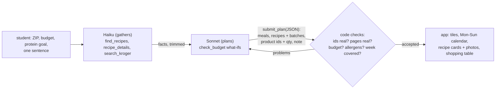

# Broke Student Aid

A college student types **ZIP code, weekly budget, and one sentence** ("I'm broke till Friday, no peanuts, tired of rice")
and gets a **week of meals**: recipes from the free cookbook *Good and Cheap*, a shopping list with **today's real prices
at their nearest Kroger**, nutrition, and a Mon–Sun calendar. Every price and nutrition number is computed by code;
Claude only understands the request and makes the choices.

**The rule the whole design follows: Claude does language and judgment, code does facts and math.**

| Promise | How it's kept | Measured |
|---|---|---|
| Every price is real | Claude sends product ids only; code looks up the price at the student's store | 12/12 eval plans, unknown ids refused |
| Never over budget | code rejects an over-budget plan and sends it back | 12/12 |
| Never an allergen the student named | code filters recipes and rejects a plan that breaks the diet | allergen recall 55/55, 12/12 plans |
| Feeds the student all week | code counts meals and rejects a short week while money is left | 12/12 weeks covered |

## How it works



1. **Cookbook → recipe cards.** Claude Haiku reads each page spread of the PDF into a typed JSON card (title, page,
   ingredients, steps, photo). 95 recipes, 92 photos, **$0.097 for the whole book**. Extraction eval: 34/34 hand-checked cards.
2. **Recipe search.** Hybrid BM25 + MiniLM vectors, merged with reciprocal rank fusion. A DSPy-built rewrite turns
   "something warm, no peanuts" into search text + an allergen filter: **hit@3 75% → 95%**.
3. **Safety by code.** Allergens come from keyword lists over the ingredients (with false friends swapped out first,
   so "butternut squash" never counts as a tree nut), not from the LLM. Recall 55/55 on 22 trap cards.
4. **Kroger prices.** OAuth2 client credentials → nearest store → products with regular/promo prices, sizes parsed to
   unit prices (cheapest per lb first), and nutrition labels.
5. **Nutrition.** Each recipe line ("1 cup dry lentils") is parsed by code and matched to a **hand-checked list of 87
   USDA foods**, then USDA's own portion weights (1 cup lentils = 192 g) and nutrients per 100 g. Fuzzy search was
   rejected after it matched "eggs" to *Bagels, egg*.
6. **The agent (LangGraph).** Haiku gathers facts (cheap fetching), Sonnet decides (judgment). The planner ends by
   submitting a **JSON plan**; code validates it and loops problems back. Nothing the student sees is free text from
   the model except a short note, and the eval checks that the note carries no made-up numbers.

## Results (agent eval, 12 student sentences, all checks by code, no LLM judge)

| | |
|---|---|
| All 5 checks (budget, complete plan, no made-up numbers, diet, real pages) | **12/12** |
| Week covered | **12/12** |
| Cost / time per answer | **$0.037**, ~30 s |
| Unit tests (no API calls, ~10 s) | **87 passing** |

How it got there (each row is a real failure the eval caught): see [ARCHITECTURE.md](ARCHITECTURE.md), the build log
with every diagram and number. Highlights: cost $0.15 → $0.03 per answer by splitting Haiku/Sonnet jobs and caching;
8/10 → 10/10 by making the final answer a JSON plan instead of prose; 599 → 908 median kcal/day by enforcing the week.

## Run it

Needs Python 3.12+. Keys can go in a `.env` file (never committed), or each user can enter their own in the app's
🔑 API keys panel (sent per request, never stored on the server):

```
ANTHROPIC_API_KEY=...       # console.anthropic.com
KROGER_CLIENT_ID=...        # developer.kroger.com, scope product.compact
KROGER_CLIENT_SECRET=...
FDC_API_KEY=...             # fdc.nal.usda.gov/api-guide
```

```bash
python3 -m pip install -r requirements.txt
```

The cookbook-derived data isn't in the repo (the book is CC BY-NC-SA). Build it once (~$0.10 of Claude calls):

```bash
mkdir -p recipes_rag/data/raw && curl -L -o recipes_rag/data/raw/good-and-cheap.pdf "https://web.archive.org/web/20240721235918id_/https://cookbooks.leannebrown.com/good-and-cheap.pdf"
```

```bash
python3 recipes_rag/run_all.py haiku && python3 recipes_rag/nutrition.py
```

Then start the API and the React page (two terminals; needs Node 20+), and open http://localhost:5173:

```bash
python3 -m uvicorn api.main:api --port 8000
```

```bash
cd web && npm install && npm run dev
```

The first version of the screen (Streamlit) still runs with `python3 -m streamlit run app.py`.

```bash
python3 run_evals.py            # unit tests + component evals, ~$0
```

```bash
python3 run_evals.py --agent    # + the 12-case agent eval, ~$0.45
```

## Where things live

| Folder | What |
|---|---|
| `recipes_rag/` | PDF → cards (`read_page.py`, `run_all.py`), search, DSPy rewrite, allergens (`diet.py`), USDA nutrition |
| `kroger/` | store lookup, products, unit prices, labels (`browse.py`) |
| `grocery/` | recipe lines → grocery names, basket → recipes |
| `agent/` | tools (incl. `submit_plan`), LangGraph graph, agent eval |
| `tests/` | unit tests for the code parts, the API with a fake agent, and the Streamlit app rendered by its test runner |
| `api/` | FastAPI: the agent streamed over server-sent events, store, products, recipes |
| `web/` | React + TypeScript page (Vite): live steps, tiles, week calendar, recipe pop-up, Browse |
| `app.py` | the first screen (Streamlit); logic stays in `agent/`, so screens can be swapped |
| `PLAN.md`, `ARCHITECTURE.md` | the plan, and the build log with every decision and number |

Recipes and photos: *Good and Cheap* by Leanne Brown, CC BY-NC-SA 4.0.
